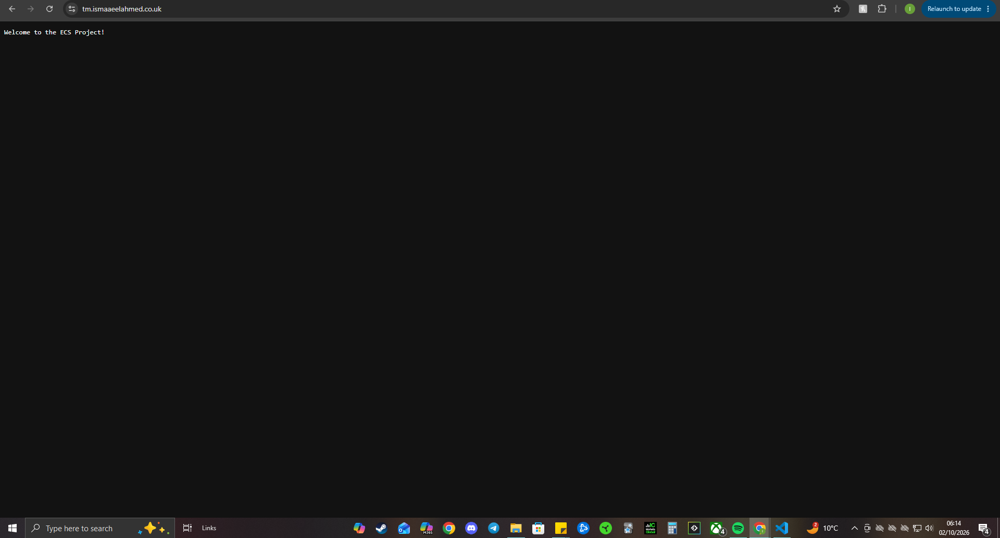

# DevOps Engineering Portfolio | Production-Grade AWS, Terraform, Kubernetes & CI/CD

**AWS · Linux · Bash · Git · Networking · Docker · Terraform · GitHub Actions · Kubernetes · GitOps · Observability**

I'm a UK-based **DevOps / Cloud Engineering candidate** with hands-on experience building, automating, deploying and troubleshooting cloud infrastructure, containerised applications and Kubernetes environments.

My portfolio includes **three end-to-end engineering projects** applying production-grade DevOps practices across infrastructure as code, CI/CD, networking, security, GitOps and monitoring.

- **AWS ECS Fargate:** Containerised Go application deployed on AWS using eight Terraform modules, Docker, ECR, ALB, HTTPS and GitHub Actions.
- **Amazon EKS:** Kubernetes platform built with Terraform, NGINX Ingress, Argo CD GitOps, HTTPS and Prometheus/Grafana monitoring.
- **Self-Managed Kubernetes:** Independently built two-node Kubernetes cluster using Ubuntu, kubeadm, containerd and Calico.

This repository is the **technical foundation and project hub** of my portfolio. It contains practical labs, scripts, infrastructure code, CI/CD workflows, architecture diagrams, deployment evidence and documented troubleshooting.

My focus is on understanding how infrastructure works, automating repeatable processes, investigating failures and building systems that can be explained, maintained and improved.

> **Project status:** The AWS ECS and EKS environments were successfully deployed and demonstrated, then intentionally destroyed to avoid ongoing AWS charges. Historical application URLs are not live demos. The kubeadm project is a local VirtualBox-based Kubernetes lab. Source code, configuration, screenshots and technical walkthroughs remain available.

**[AWS ECS Fargate](#1-aws-ecs-fargate--production-grade-infrastructure--cicd)** · **[Amazon EKS](#2-amazon-eks--production-grade-kubernetes-gitops--observability)** · **[Self-Managed Kubernetes](#3-self-managed-kubernetes--kubeadm--cluster-operations)** · **[Technical Skills](#technical-skills--linked-to-implementation)** · **[Nine Modules](#technical-foundations--nine-hands-on-modules)** · **[Troubleshooting](#engineering-problem-solving--real-issues-resolved)**

---

## Featured Engineering Projects

Three complementary projects demonstrating **AWS infrastructure automation, managed Kubernetes engineering and independent Linux-based Kubernetes administration**.

| Project | Engineering Implementation | Verified Evidence |
| --- | --- | --- |
| **[AWS ECS Fargate — Production-Grade Infrastructure & CI/CD](ecs-project/)** | Go, Docker, ECR, eight Terraform modules, ALB, ACM, IAM/OIDC, GitHub Actions and CloudWatch | 4.42 MB container image, working HTTPS application, successful Terraform provisioning and four GitHub Actions workflows |
| **[Amazon EKS — Production-Grade Kubernetes & GitOps](https://github.com/ismaaeelahmed11/eks-project)** | Terraform, Kubernetes, Helm, NGINX Ingress, cert-manager, ExternalDNS, Argo CD, Prometheus and Grafana | Two IT-Tools replicas, HTTPS application access, Argo CD `Synced / Healthy` and monitoring dashboards |
| **[Self-Managed Kubernetes — kubeadm & Cluster Operations](https://github.com/ismaaeelahmed11/kubeadm-kubernetes-lab)** | Ubuntu, VirtualBox, kubeadm, containerd, Calico, Kubernetes networking and workloads | Two `Ready` nodes, four NGINX replicas, Pod replacement, rolling updates and rollback |

**Technical walkthroughs:** [ECS (2:11)](https://youtu.be/qpIZlJkWmos) · [EKS (2:29)](https://youtu.be/RDmnaTi2auE) · [kubeadm (2:00)](https://youtu.be/a9hATioCGcs)

---

### 1. AWS ECS Fargate — Production-Grade Infrastructure & CI/CD

**AWS ECS · ECR · Go · Docker · Terraform · ALB · ACM · Cloudflare · GitHub Actions · IAM/OIDC · CloudWatch**

Built and deployed a containerised **Go HTTP application on Amazon ECS Fargate**, applying production-grade engineering practices across infrastructure provisioning, CI/CD, networking, identity, HTTPS and application logging.

I initially configured the infrastructure manually to understand AWS service dependencies before rebuilding it through **eight reusable Terraform modules** and automating infrastructure operations with GitHub Actions.

#### Engineering Implementation

- Developed and containerised a Go HTTP application using a **multi-stage Dockerfile**, producing a **4.42 MB**, non-root, `scratch`-based image.
- Provisioned AWS infrastructure through **eight Terraform modules**, covering VPC, ECR, security groups, IAM, ACM, ALB, ECS and OIDC.
- Configured **Amazon S3 remote Terraform state** with encryption, versioning and native state locking.
- Built VPC networking across two public subnets and configured an **Application Load Balancer**, IP target group, health checks and HTTPS.
- Integrated **AWS Certificate Manager** and Cloudflare DNS for custom-domain application access.
- Created **four GitHub Actions workflows** covering Docker image publishing, Terraform planning, infrastructure provisioning and controlled teardown.
- Implemented **GitHub Actions OIDC federation** for short-lived AWS authentication without long-lived access keys.
- Enabled **Amazon CloudWatch Logs** for application logging and troubleshooting.

#### Troubleshooting & Problem Solving

- **Container startup:** Investigated a privileged-port binding failure and aligned the Go application, ECS task, target group and security group on port `8080`.
- **IAM permissions:** Fixed CloudWatch logging failures caused by missing permissions on the ECS execution role.
- **Terraform compatibility:** Resolved S3 native state-locking issues by aligning Terraform versions between the local environment and CI.
- **GitHub Actions:** Corrected workflow file placement when pipelines failed to trigger.
- **Load balancing:** Diagnosed and resolved an ALB target group conflict during provisioning.

#### Verified Outcome

Successfully deployed the Go application through Terraform-managed AWS infrastructure with **HTTPS access, application health checks, CloudWatch logging and automated infrastructure workflows**.

The application was tested at `tm.ismaaeelahmed.co.uk` before the AWS resources were removed.

**Deployment evidence — Terraform-managed ECS application over HTTPS**



**[View ECS source code & full technical README](ecs-project/)** · **[Architecture diagram](ecs-project/screenshots/39b-architecture-drawio.png)** · **[GitHub Actions evidence](ecs-project/screenshots/37b-ci-cd-both-pipelines-green.png)** · **[Terraform provisioning evidence](ecs-project/screenshots/31-terraform-apply-ecs.png)** · **[Watch walkthrough (2:11)](https://youtu.be/qpIZlJkWmos)**

> **CI/CD scope:** The image-publishing workflow builds and pushes Docker images to ECR. Publishing an image does not, by itself, automatically deploy a new ECS service revision. That release distinction and the next improvement are documented in the detailed project README.

---

### 2. Amazon EKS — Production-Grade Kubernetes, GitOps & Observability

**AWS EKS · Terraform · Kubernetes · Helm · NGINX Ingress · Argo CD · Prometheus · Grafana · GitHub Actions**

Designed, provisioned and troubleshot an end-to-end **Amazon EKS Kubernetes platform**, applying production-grade DevOps practices across infrastructure automation, container orchestration, GitOps, HTTPS, monitoring and security reporting.

The project involved AWS networking, Kubernetes workload configuration, Git-based application reconciliation, CI/CD automation and troubleshooting across several layers of the infrastructure.

#### Engineering Implementation

- Provisioned an AWS VPC, subnets and EKS cluster using **Terraform**, configuring a managed node group with a **desired capacity of four workers across two Availability Zones**.
- Deployed the **IT-Tools application with two Kubernetes replicas**, readiness/liveness probes and resource controls.
- Configured **NGINX Ingress behind an AWS Network Load Balancer** for application traffic.
- Implemented **cert-manager, Let's Encrypt and ExternalDNS** for HTTPS certificates and Cloudflare DNS management.
- Integrated **Argo CD GitOps** for Git-based application synchronisation, automated reconciliation and workload management.
- Deployed **Prometheus and Grafana** for Kubernetes monitoring, metrics collection and dashboards.
- Configured **Amazon EBS CSI Driver and IAM permissions** for persistent storage required by monitoring workloads.
- Built **GitHub Actions workflows** using AWS OIDC authentication for infrastructure and application tasks.
- Integrated **Checkov and Trivy** for infrastructure and container security reporting.

#### Troubleshooting & Problem Solving

- **Persistent storage:** Investigated PVC provisioning failures and configured the EBS CSI Driver with the required IAM permissions.
- **Pod scheduling:** Diagnosed workloads stuck in `Pending` because of resource capacity constraints and adjusted managed node-group capacity.
- **AWS authentication:** Investigated OIDC trust-policy conditions affecting GitHub Actions access.
- **EKS access:** Resolved conflicting cluster access settings through explicit EKS access configuration.
- **Application networking:** Investigated service routing and ingress configuration to verify working HTTPS application access.

#### Verified Outcome

Successfully demonstrated the Kubernetes application over **HTTPS**, with Argo CD reporting **`Synced` and `Healthy`** and Prometheus/Grafana providing monitoring visibility.

The managed node group was configured for four desired workers; the preserved evidence also documents cluster operation during earlier node-capacity stages.

**Deployment evidence — Argo CD application reconciliation**


**[View EKS source code & full technical README](https://github.com/ismaaeelahmed11/eks-project)** · **[Architecture diagram](https://github.com/ismaaeelahmed11/eks-project/blob/main/screenshots/31-architecture-drawio.png)** · **[HTTPS application evidence](https://github.com/ismaaeelahmed11/eks-project/blob/main/screenshots/17-it-tools-live-https.png)** · **[Grafana dashboard](https://github.com/ismaaeelahmed11/eks-project/blob/main/screenshots/27-grafana-dashboard.png)** · **[Watch walkthrough (2:29)](https://youtu.be/RDmnaTi2auE)**

> **Engineering scope:** This project demonstrates production-grade engineering practices, not an independently certified commercial production service. Checkov/Trivy scans provided non-blocking findings. Defining one release owner between direct GitHub Actions deployment and Argo CD reconciliation is a documented improvement.

---

### 3. Self-Managed Kubernetes — kubeadm & Cluster Operations

**Ubuntu · VirtualBox · kubeadm · containerd · Calico · kubectl · Linux · Kubernetes Networking**

Following my Amazon EKS project, I independently built a **two-node Kubernetes cluster on Ubuntu virtual machines** to develop a deeper understanding of Kubernetes administration outside a managed cloud platform.

Instead of relying on AWS to manage the control plane, I configured the Linux environment, container runtime, node connectivity and Kubernetes networking directly.

#### Engineering Implementation

- Created Ubuntu control-plane and worker-node virtual machines using **Oracle VirtualBox**.
- Configured **NAT, host-only networking and static IP addresses** for node communication and host access.
- Bootstrapped Kubernetes v1.35.9 using **kubeadm**.
- Configured **containerd** as the container runtime and installed **Calico CNI** for Kubernetes pod networking.
- Joined a worker node to the control plane and verified cluster readiness.
- Deployed **four NGINX replicas** using declarative Kubernetes manifests.
- Configured **ClusterIP and NodePort Services**, health probes and CPU/memory requests and limits.
- Tested **manual scaling, Pod self-healing, rolling updates and rollback**.
- Documented the implementation through Kubernetes manifests, architecture diagrams and **19 supporting screenshots**.

#### Troubleshooting & Problem Solving

- **Virtualisation:** Investigated CPU lockups and VM instability during Kubernetes bootstrap.
- **Cluster administration:** Diagnosed administrative Kubernetes API access and RBAC issues.
- **Networking:** Verified Calico pod networking, node communication and Kubernetes system-component health.
- **Workload operations:** Confirmed that the Deployment controller replaced a deleted Pod and maintained the intended replica count.

#### Verified Outcome

Demonstrated a functioning self-managed Kubernetes environment with:

- **Two nodes reporting `Ready`**
- **Four available NGINX replicas**
- Application access from the Windows host through NodePort
- Successful Pod replacement after deletion
- Rolling-update and rollback testing

**Deployment evidence — Kubernetes control plane and worker node Ready**


**[View kubeadm source code & full technical README](https://github.com/ismaaeelahmed11/kubeadm-kubernetes-lab)** · **[Architecture diagram](https://github.com/ismaaeelahmed11/kubeadm-kubernetes-lab/blob/main/screenshots/59-kubeadm-kubernetes-architecture.png)** · **[Four-replica evidence](https://github.com/ismaaeelahmed11/kubeadm-kubernetes-lab/blob/main/screenshots/55-nginx-horizontal-scaling-four-replicas.png)** · **[Self-healing evidence](https://github.com/ismaaeelahmed11/kubeadm-kubernetes-lab/blob/main/screenshots/54-kubernetes-self-healing-replacement-pod.png)** · **[Watch walkthrough (2:00)](https://youtu.be/a9hATioCGcs)**

> **Operational scope:** The lab demonstrates self-managed cluster setup and Pod-level recovery, scaling and rollout operations. It does not claim worker-node high availability, disaster recovery, long-term production operation or a completed Kubernetes version-upgrade procedure.

---

## Technical Skills — Linked to Implementation

The technologies below are supported by **hands-on code, configurations, project evidence or documented exercises**.

| Area | Practical Implementation | Evidence |
| --- | --- | --- |
| **Linux & Ubuntu** | Shell administration, permissions, processes, SSH, text processing, networking and Ubuntu VM configuration | [Linux labs](linux/) · [kubeadm project](https://github.com/ismaaeelahmed11/kubeadm-kubernetes-lab) |
| **Bash Scripting** | Calculator, file automation, permission checking, backup scripts and shell troubleshooting | [Bash scripts](bash-scripting/) |
| **Git & GitHub** | Branching, merging, rebase, conflict resolution, stash, revert and history recovery | [Git labs](https://github.com/ismaaeelahmed11/git-labs) |
| **Networking** | TCP/IP, DNS, SSH, VPCs, subnetting, routing, security groups, load balancing and Kubernetes networking | [Networking labs](networking/) · [ECS Terraform](ecs-project/terraform/) |
| **Docker** | Dockerfiles, multi-stage builds, Docker Compose, container registries and application networking | [Docker labs](docker/) · [ECS Dockerfile](ecs-project/Dockerfile) |
| **AWS** | EC2, VPC, IAM, ECR, ECS Fargate, EKS, ALB, ACM, CloudWatch and security groups | [AWS labs](aws/) · [ECS](ecs-project/) · [EKS](https://github.com/ismaaeelahmed11/eks-project) |
| **Terraform** | Reusable modules, variables, outputs, AWS resource provisioning, S3 remote state and locking | [Terraform labs](terraform/) · [ECS infrastructure](ecs-project/terraform/) |
| **CI/CD** | GitHub Actions, automated tests, image publishing, Terraform planning, apply/teardown and AWS OIDC | [CI/CD labs](cicd/) · [GitHub Actions workflows](.github/workflows/) |
| **Kubernetes & Helm** | Deployments, Services, Ingress, health probes, resource controls, kubeadm, Calico and Helm-based deployment | [Kubernetes labs](k8s/exercises/) · [EKS](https://github.com/ismaaeelahmed11/eks-project) · [kubeadm](https://github.com/ismaaeelahmed11/kubeadm-kubernetes-lab) |
| **GitOps & Observability** | Argo CD reconciliation, Prometheus metrics, Grafana dashboards and CloudWatch logging | [EKS project](https://github.com/ismaaeelahmed11/eks-project) |
| **Security Practices** | AWS IAM, OIDC authentication, HTTPS/TLS, non-root containers and Checkov/Trivy reporting | [ECS IAM/OIDC](ecs-project/terraform/modules/) · [EKS workflows](https://github.com/ismaaeelahmed11/eks-project/tree/main/.github/workflows) |

---

## Technical Foundations — Nine Hands-On Modules

These modules provided the foundation for the larger ECS, EKS and kubeadm projects.

Each area includes practical exercises, implementation notes, scripts and supporting evidence where available.

### 01 · Linux & System Administration

**Ubuntu · Shell · SSH · Permissions · Processes · Text Processing**

- Practised Linux navigation, filesystem operations, permissions and ownership.
- Used `grep`, `sed`, `awk`, regular expressions, pipes and redirection for text processing.
- Worked with process management, SSH, file searches and archive handling.
- Completed and documented **OverTheWire Bandit levels 0–20**, preserving notes and screenshots.

**[Explore Linux labs & Bandit evidence](linux/)**

### 02 · Bash Scripting & Automation

**Bash · Variables · Conditions · Loops · Functions · Exit Codes**

- Built an interactive **arithmetic calculator** with division-by-zero handling.
- Automated directory and file operations.
- Created a **file permission checker** for readable, writable and executable states.
- Developed a **timestamped backup script**.
- Troubleshot shell quoting, globbing, variables and command execution.

**[Explore Bash scripts](bash-scripting/)**

### 03 · Git & Version Control

**Git · GitHub · Branching · Merging · Rebase · Recovery**

- Practised `clone`, `add`, `commit`, `push`, `pull`, branching and merging.
- Resolved merge conflicts and worked with rebase, stash, reset, revert and cherry-pick.
- Used reflog to investigate and recover Git history.
- Configured SSH authentication, `.gitignore` and pre-commit hooks.
- Applied version control to Terraform modules, Kubernetes manifests and CI/CD configurations.

**[Explore Git labs](https://github.com/ismaaeelahmed11/git-labs)**

### 04 · Networking & Connectivity

**TCP/IP · DNS · SSH · HTTP · Routing · AWS Security Groups**

- Deployed **NGINX on an Ubuntu EC2 instance** and configured access using Cloudflare DNS.
- Configured EC2 security-group rules for SSH and HTTP traffic.
- Diagnosed an HTTP timeout caused by a missing inbound port-80 rule.
- Used `dig` and `nslookup` to investigate DNS behaviour.
- Applied networking concepts in AWS VPC, load-balancing and Kubernetes projects.

**[Explore networking labs](networking/)**

### 05 · Docker & Containerisation

**Docker · Docker Compose · Flask · Redis · Container Registries**

- Built, tagged and ran Docker images from Dockerfiles.
- Deployed a **Flask and Redis application using Docker Compose**.
- Worked with container networking, exposed ports, logs and environment configuration.
- Investigated multi-stage build dependencies and port conflicts.
- Practised publishing images to Docker Hub and Amazon ECR.
- Applied containerisation skills in the AWS ECS Fargate project.

**[Explore Docker labs](docker/)**

### 06 · AWS Infrastructure

**EC2 · VPC · Subnets · Internet Gateways · Load Balancers · IAM**

- Provisioned AWS networking resources, including subnets, route tables, gateways and security groups.
- Configured EC2 instances and user-data scripts.
- Worked with Application Load Balancers, target groups and health checks.
- Practised AWS IAM and infrastructure access concepts.
- Applied these fundamentals across ECS and EKS infrastructure deployments.

**[Explore AWS labs](aws/)**

### 07 · Terraform & Infrastructure as Code

**Terraform · HCL · AWS · Variables · Outputs · Remote State**

- Provisioned a **WordPress EC2 environment** using Terraform and cloud-init.
- Practised `terraform init`, `plan`, `apply` and `destroy`.
- Used variables, outputs and Terraform configuration files.
- Progressed from individual resources to reusable infrastructure modules.
- Configured S3-backed remote state and locking in the ECS project.
- Applied Terraform across AWS ECS and EKS infrastructure.

**[Explore Terraform labs](terraform/)** · **[View ECS Terraform modules](ecs-project/terraform/)**

### 08 · CI/CD with GitHub Actions

**GitHub Actions · Pytest · Docker · YAML · Workflow Triggers**

- Created a CI workflow for running **Python/Flask tests**.
- Built a Docker image-publishing workflow targeting Docker Hub.
- Worked with push/pull-request triggers, workflow YAML and repository secrets.
- Investigated failed workflow runs and corrected automation configuration.
- Extended CI/CD concepts into AWS infrastructure workflows using short-lived OIDC authentication.

**[Explore CI/CD labs](cicd/)** · **[View GitHub Actions workflows](.github/workflows/)**

### 09 · Kubernetes & Workload Management

**kubectl · Pods · Deployments · Services · ConfigMaps · Secrets**

- Practised Kubernetes resources, deployments and workload inspection.
- Worked with Services, resource configuration and storage concepts.
- Used Kind and Killercoda for Kubernetes exercises.
- Applied Kubernetes knowledge to a Terraform-provisioned Amazon EKS environment.
- Independently built a self-managed kubeadm cluster to develop deeper administration and troubleshooting skills.

**[Explore Kubernetes labs](k8s/exercises/)** · **[View independent kubeadm project](https://github.com/ismaaeelahmed11/kubeadm-kubernetes-lab)**

---

## Engineering Problem-Solving — Real Issues Resolved

A major part of my engineering work has involved diagnosing failures rather than only documenting successful deployments.

I preserve troubleshooting notes alongside working configurations because understanding **why something broke and how it was resolved** is essential to building reliable infrastructure.

| Issue | Investigation & Resolution | Engineering Skills Demonstrated |
| --- | --- | --- |
| **ECS task failed during startup** | Investigated non-root execution and privileged-port binding; aligned the Go listener, ECS task, target group and security group on port `8080` | Docker, Linux permissions, ECS networking |
| **CloudWatch logging failure** | Inspected IAM permissions and corrected missing `logs:CreateLogGroup` access | AWS IAM, logging and diagnostics |
| **Terraform S3 state-locking failure** | Investigated version compatibility and updated Terraform in GitHub Actions from `1.9.0` to `1.11.0` | Terraform, CI/CD, tool compatibility |
| **GitHub Actions workflows not triggering** | Found workflow files in a project subdirectory and moved them into repository-root `.github/workflows/` | CI/CD, GitHub repository structure |
| **EKS monitoring Pods and PVCs Pending** | Investigated node capacity, EBS CSI provisioning and IAM permissions; configured storage access and adjusted capacity | Kubernetes scheduling, storage, AWS IAM |
| **EKS authentication and access conflicts** | Diagnosed OIDC trust-policy conditions and conflicting cluster access settings | IAM/OIDC, EKS access management |
| **kubeadm bootstrap and VM instability** | Investigated VirtualBox CPU issues, Kubernetes component health and administrative API/RBAC access | Linux, virtualisation, cluster troubleshooting |

**Detailed technical investigations:**

- [ECS troubleshooting & root-cause analysis](ecs-project/#troubleshooting--root-cause-analysis)
- [EKS troubleshooting & root-cause analysis](https://github.com/ismaaeelahmed11/eks-project#troubleshooting-and-root-cause-analysis)
- [kubeadm troubleshooting & root-cause investigation](https://github.com/ismaaeelahmed11/kubeadm-kubernetes-lab#troubleshooting--root-cause-investigation)

---

## Repository Guide

```text
devops-learning/
├── .github/workflows/      # GitHub Actions CI/CD and AWS workflows
├── aws/                    # AWS infrastructure and networking exercises
├── bash-scripting/         # Bash scripts and automation exercises
├── cicd/                   # Automated testing and CI/CD labs
├── docker/                 # Dockerfiles and Docker Compose applications
├── ecs-project/            # Production-grade AWS ECS Fargate project
├── k8s/exercises/          # Kubernetes workload and configuration exercises
├── linux/                  # Linux notes, exercises and Bandit evidence
├── networking/             # DNS, SSH, HTTP and networking labs
├── terraform/              # Terraform and cloud-init exercises
└── README.md               # Engineering portfolio and project hub
```

### Related Engineering Repositories

The following projects have dedicated repositories containing their own technical READMEs, implementation files and evidence:

- **[eks-project](https://github.com/ismaaeelahmed11/eks-project)** — Production-grade Amazon EKS infrastructure, Terraform, GitOps, monitoring, security reporting and troubleshooting.
- **[kubeadm-kubernetes-lab](https://github.com/ismaaeelahmed11/kubeadm-kubernetes-lab)** — Independent self-managed Kubernetes infrastructure, Linux administration, Calico networking and operational testing.
- **[git-labs](https://github.com/ismaaeelahmed11/git-labs)** — Git workflows, branching, merging, history management and recovery exercises.

---

## My Engineering Approach

I enjoy understanding systems end to end, particularly when they don't behave as expected.

The most valuable engineering lessons have come from diagnosing authentication failures, networking issues, Kubernetes scheduling problems, persistent storage errors and CI/CD configuration mistakes.

My approach is to:

1. **Understand the architecture:** Identify how services, network traffic, permissions and dependencies interact.
2. **Build and verify:** Implement the infrastructure or workload and inspect its actual behaviour.
3. **Automate repeatable work:** Use Terraform, Bash, GitHub Actions and declarative Kubernetes manifests.
4. **Apply security practices:** Prefer short-lived credentials, IAM permissions, HTTPS and security visibility.
5. **Monitor and troubleshoot:** Use logs, metrics, health checks and command-line tools to identify root causes.
6. **Document evidence:** Preserve configurations, diagrams, screenshots, troubleshooting and known limitations.
7. **Improve the design:** Identify opportunities to strengthen reliability, security, automation and maintainability.

### Project Context & Engineering Standards

I completed the **CoderCo DevOps Engineering programme (January–October 2026)**, covering nine hands-on modules.

The AWS ECS and EKS projects were completed as part of this programme. I subsequently built the kubeadm Kubernetes lab independently to strengthen my Linux and Kubernetes administration knowledge.

The AWS projects used **real cloud infrastructure and production-grade engineering practices**, including:

- Infrastructure as Code
- Reusable Terraform modules
- CI/CD automation
- Short-lived AWS OIDC authentication
- IAM permissions and security controls
- HTTPS/TLS
- Application health checks
- Monitoring and logging
- GitOps
- Documented troubleshooting

These were **hands-on portfolio deployments rather than commercially operated production services**. Where reliability controls, security gates, high availability or automation steps were not fully implemented or tested, their limitations are documented in the relevant project README.

Alongside these projects, I bring **two years of professional IT support experience**, troubleshooting Windows systems, networking, staff access and day-to-day technical operations.

I'm pursuing opportunities in **DevOps Engineering, Cloud Engineering, Platform Engineering and Infrastructure Operations**, where I can contribute practical technical skills and continue developing production engineering experience.

---

## Contact & Technical Walkthroughs

**Ismaaeel Ahmed — DevOps & Cloud Engineering**

**United Kingdom · British citizen · No visa sponsorship required**

**[GitHub](https://github.com/ismaaeelahmed11)** · **[LinkedIn](https://www.linkedin.com/in/ismaaeelahmed)** · **[Email](mailto:ismaaeelahmed11@gmail.com)**

**Project Walkthroughs**

- [AWS ECS Fargate — Infrastructure, Terraform & CI/CD (2:11)](https://youtu.be/qpIZlJkWmos)
- [Amazon EKS — Kubernetes, GitOps & Observability (2:29)](https://youtu.be/RDmnaTi2auE)
- [Self-Managed Kubernetes — kubeadm & Cluster Operations (2:00)](https://youtu.be/a9hATioCGcs)

---

*Building infrastructure. Automating delivery. Understanding systems.*
